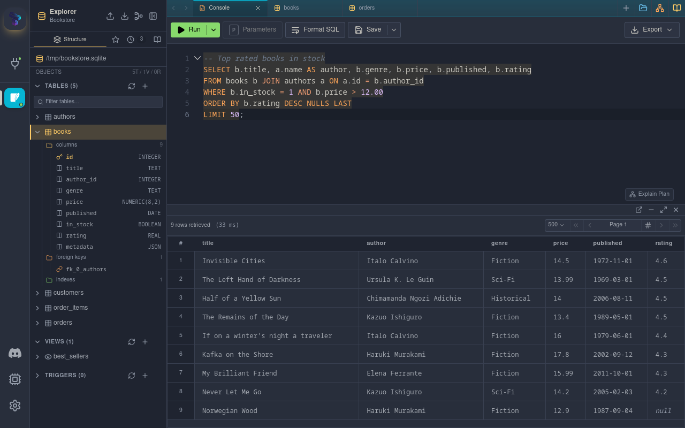
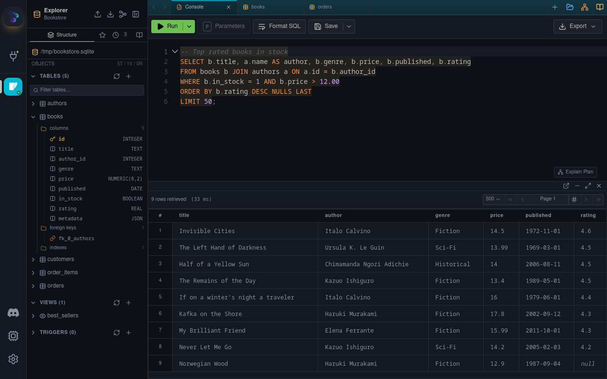
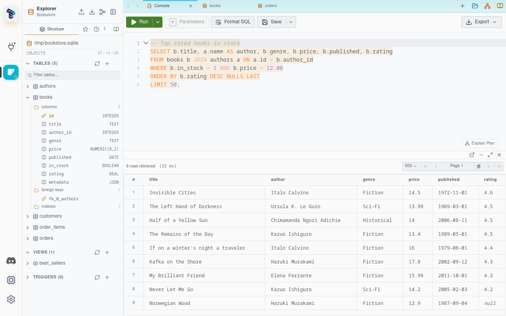

# Ayu for Tabularis

[](https://github.com/TabularisDB/tabularis-ayu-theme/actions/workflows/validate.yml)

The [ayu](https://github.com/ayu-theme/ayu-colors) palette for [Tabularis](https://tabularis.dev), in all three official variants:

- **Ayu Light**: bright and clean, with orange accents.
- **Ayu Mirage**: the mid-tone blue-grey variant.
- **Ayu Dark**: deep navy-black with golden accents.

Each variant styles the application, SQL editor and data grid. Themes are declarative JSON, not executable plugins.

| Ayu Mirage | Ayu Dark | Ayu Light |
| --- | --- | --- |
|  |  |  |

| Variant | Background | Text | Accent |
| --- | --- | --- | --- |
| Ayu Light | `#f8f9fa` | `#3a3f45` | `#f29718` |
| Ayu Mirage | `#1f2430` | `#cccac2` | `#ffcc66` |
| Ayu Dark | `#0d1017` | `#bfbdb6` | `#e6b450` |

## Palette and accessibility

Colors come from the official ayu palette (ayu-colors 9.1.0). SQL syntax in the
editor uses the original ayu syntax colors unchanged.

Application colors (text, status colors, data types in the grid, focus ring) are
held to WCAG 2.2 AA, the same contrast checks Tabularis applies to its built-in
themes: 4.5:1 for text and 3:1 for focus indicators. Where an ayu color falls
short, it is replaced by the nearest shade of the same hue that passes. This
mostly affects Ayu Light, whose original pastel accents are too light for text
on a white background, and the muted text of Mirage and Dark.

## Compatibility

Requires Tabularis **0.25.1-1 or later**, the first release that accepts a theme
manifest with a stable package `id` and a free-form display `name`.

## Installation

1. Download `theme-universal.zip` from this repository's GitHub Releases.
2. In Tabularis, open **Settings → Appearance → Manage themes → Local package**.
3. Preview and install the package.
4. Select **Ayu Light**, **Ayu Mirage** or **Ayu Dark** and apply it. Installation alone does not change the selected theme.

The ZIP is universal: the same file works on all supported operating systems.

## Editing and validation

Edit `themes/light.json`, `themes/mirage.json` and `themes/dark.json`. Application
colors live under `colors`; Monaco colors and SQL token rules live under `editor`.

The `$schema` hints let external editors offer completion and validation:

| File | Public schema |
| --- | --- |
| `.tabularium` | https://registry.tabularis.dev/manifest.schema.json?kind=theme |
| `themes/*.json` | https://raw.githubusercontent.com/TabularisDB/tabularis/main/src/schemas/theme-definition-v1.json |

Validate and package offline with Node.js 22, no account or token needed:

```sh
node tools/theme.mjs validate .
node tools/theme.mjs package . --output theme-universal.zip
```

Validation does not submit or publish the theme.

## CI and releases

- **Branch pushes / pull requests:** validate and package the theme offline. The
  workflow has read-only permissions and needs no secrets.
- **Version tags:** check that the tag matches the manifest version, validate,
  package, then create a **draft** GitHub release with `theme-universal.zip` and
  the `.tabularium` manifest attached.

Releasing a version:

1. Increment `version` in `.tabularium`. If the theme starts relying on newer host
   features, raise `min_runtime_version` to the first Tabularis release providing them.
2. Tag and push:

   ```sh
   git tag v1.0.0
   git push origin v1.0.0
   ```

3. Review the generated draft, then publish the release.
4. Submit this repository through Tabularium. Registry approval and ingestion are
   separate from GitHub release publication.

Keep the package `id` and variant IDs stable across versions.

## License

MIT. The ayu color palette is © Konstantin Pschera, also MIT licensed. See
[LICENSE.txt](LICENSE.txt).
